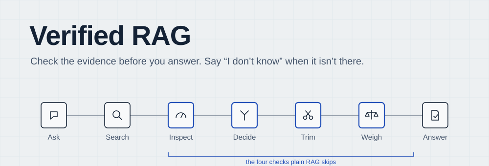
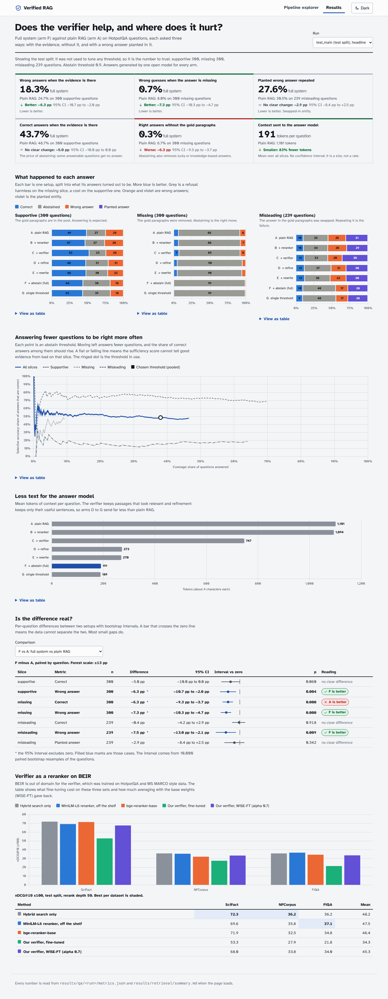
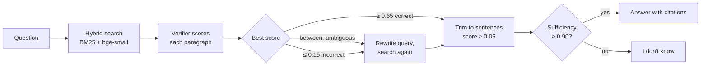

<picture>
  <source media="(prefers-color-scheme: dark)" srcset="docs/assets/banner-dark.svg">
  
</picture>

<p>
  <a href="https://github.com/Nadercr7/CRAG/actions/workflows/ci.yml"></a>
  
  <a href="LICENSE"></a>
</p>

A language model that answers from search results trusts whatever the search hands it. Verified RAG puts a small cross-encoder between retrieval and generation. It scores every retrieved paragraph, searches again when the evidence is weak, trims paragraphs to the sentences that matter, and abstains when what is left can't support an answer.

**[Project page](https://nadercr7.github.io/CRAG/)** · **[Explainer](https://nadercr7.github.io/CRAG/explainer.html)** (English and Egyptian Arabic) · **[Slides](https://nadercr7.github.io/CRAG/slides.html)** · **[Results report](results/report.md)**

## Results

Tested once on 300 held-out HotpotQA questions, each asked three ways: with the gold paragraphs (supportive), with them removed (missing), and with the answer swapped for a wrong one inside them (misleading). Every setup uses the same answer model, Qwen3-4B-Instruct.

| | Plain RAG | Verified RAG | Paired difference (95% CI) |
|---|---|---|---|
| Hallucination, supportive | 24.7% | 18.3% | −6.3 pp [−10.7, −2.0] |
| Hallucination, missing | 8.0% | 0.7% | −7.3 pp [−10.3, −4.7] |
| Hallucination, misleading | 24.7% | 17.2% | −7.5 pp [−13.0, −2.1] |
| Correct, supportive | 48.7% | 43.7% | −5.0 pp [−10.0, 0.0] |
| Context sent to the model | ~1,070 tokens | ~217 tokens | |

The gain comes with a cost: the system answers fewer questions (62% of supportive questions against 73%). It also does not catch a fluent paragraph with a planted wrong answer, and the query-rewrite step had no measurable effect. The [report](results/report.md) covers every number, how each threshold was chosen on the dev split before the test run, and what went wrong along the way.



## How it works



- **Verifier:** `cross-encoder/ms-marco-MiniLM-L6-v2` fine-tuned on HotpotQA passages and sentences plus MS MARCO, then averaged with its base weights (WiSE-FT, α = 0.7) so it keeps ranking well outside HotpotQA. Platt-calibrated.
- **Sufficiency model:** MiniLM-L12 cross-encoder trained on 270k HotpotQA-derived examples; dev AUC 0.978 against contexts missing one hop.
- **Every request returns a trace** (scores, decision, rewritten queries, kept and dropped sentences, sufficiency, timings) that the UI renders.

The design builds on [CRAG](https://arxiv.org/abs/2401.15884) (Yan et al., 2024) and [Sufficient Context](https://arxiv.org/abs/2411.06037) (Joren et al., ICLR 2025).

## Quick start

```bash
git clone https://github.com/Nadercr7/CRAG.git && cd CRAG
python -m venv .venv && source .venv/bin/activate
pip install -e ".[dev,eval]"       # add ,train for the training scripts
pytest                             # unit tests, no network
uvicorn vrag.api.app:app           # UI at http://127.0.0.1:8000
```

The results dashboard and the 22 example traces work from a fresh clone. Asking live questions also needs:

- **The trained models.** `python scripts/kaggle_job.py fetch-models` downloads them into `data/models/` from the owner's private Kaggle dataset. Without access, rebuild them with `scripts/kaggle_job.py train` and `scripts/wise_ft.py ... --alpha 0.7`.
- **The search index** over the HotpotQA paragraph pool, built on first use by `scripts/demo_trace.py`.
- **A Groq API key** in `.env` (`cp .env.example .env`).

Without them, `POST /api/ask` returns 503 with the reason and the rest of the UI keeps working. `requirements.lock` pins the exact versions the results were produced with.

## Repository layout

| Path | What is there |
|---|---|
| [`src/vrag/retrieval`](src/vrag/retrieval) | BM25, dense retrieval and reciprocal-rank fusion |
| [`src/vrag/verifier`](src/vrag/verifier) | Training data, the cross-encoder, sufficiency examples, WiSE-FT |
| [`src/vrag/pipeline`](src/vrag/pipeline) | Calibration, the three-way decision, refinement, rewrite, sufficiency gate, answer, traces |
| [`src/vrag/eval`](src/vrag/eval) | Retrieval metrics, QA outcomes, risk-coverage, paired bootstrap |
| [`src/vrag/llm`](src/vrag/llm) | Groq client with a request cache and a rate limiter that respects daily token caps |
| [`src/vrag/api`](src/vrag/api), [`web`](web) | FastAPI app, pipeline explorer and results dashboard |
| [`scripts`](scripts) | Data building, dev tuning, QA runs, report tables, Kaggle GPU jobs |
| [`kaggle`](kaggle) | Kernels for training, scoring and batch generation with vLLM |
| [`results`](results) | Metrics, per-question outcomes, tuning tables, the LLM-judge check, [report](results/report.md) |
| [`docs`](docs) | The project page, explainer, slides and speaker guide (built from [`docs/explain`](docs/explain)) |
| [`PLAN.md`](PLAN.md), [`research`](research) | The design, the reading behind it, and what changed from the plan |

## Reproducing the evaluation

```bash
python scripts/run_qa_eval.py prepare --split test --arms A..G --out data/eval/test_main/ \
    --sufficiency data/models/sufficiency-minilm-l12 --overlay configs/tuned.toml \
    --rewrite-model local/Qwen3-4B-Instruct-2507 --offline-rewrites
python scripts/kaggle_job.py prompts data/eval/test_main/prompts.jsonl   # then generate and wait
python scripts/run_qa_eval.py finalize --run data/eval/test_main \
    --outputs data/kaggle/<job>/output/outputs.jsonl --tau-abstain 0.9
python scripts/report_tables.py > results/report_tables.md
```

Answers are generated in batch on Kaggle (2× T4, vLLM) because Groq's free tier allows 200,000 tokens a day per model. The LLM client caches every request, so a re-run costs nothing and an interrupted run resumes where it stopped.

## Rebuilding the pages

```bash
python scripts/build_explain_data.py   # docs/explain/data.js from results/
node docs/explain/build.mjs            # single-file docs/index.html, explainer, slides, guide
```

## Licence

MIT. See [LICENSE](LICENSE).
